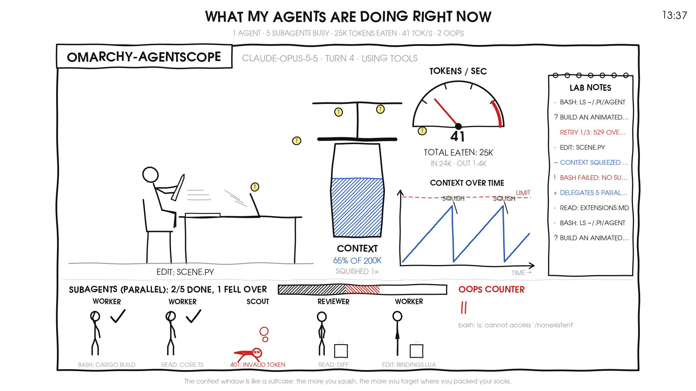

# AgentLife – xkcd-Screensaver für Agenten (pi, Claude Code, Codex)

[English version](README.en.md) · Projekt- und Programmname im Code: `agentscope`

Ein Vollbild-Screensaver für Omarchy (Hyprland), der im Strichmännchen-Stil von xkcd zeigt,
was **alle laufenden Agenten** gerade tun – inklusive Subagents, Tokenverbrauch,
Kontextfüllung, Kompaktierung und Fehlern. Mehrere Harnessse gleichzeitig:
**pi** (live über eine Erweiterung), **Claude Code** und **Codex** (aus ihren Sitzungs-Logs).



## Start

| Weg | Befehl |
|---|---|
| Tastenkürzel | **SUPER + Z** (nochmal drücken = schließen) |
| Terminal | `agentscope` |
| Demo ohne Agenten | `agentscope --demo` |
| Fenster statt Vollbild | `agentscope --windowed` (nur `q`/`Esc` schließt) |
| Sparsamer | `agentscope --fps 4` (Vorgabe: 8) |
| PNG-Vorschau | `python3 -m agentscope.snapshot out.png [--demo]` |

Beenden im Vollbild: beliebige Taste, Mausklick oder Mausbewegung (erst nach 1 s).

## Was man sieht

Jeder Agent ist ein Comic-Panel. Die Beschriftung links oben nennt den **Harness** und den
gekürzten **Skill- bzw. Sitzungsnamen** (z. B. `pi · vaultdev`); gibt es keinen Namen, steht dort
eine kurze Sitzungskennung. Ein dezent getönter **Titelkasten** unterscheidet die Harnessse
(pi = grau, Claude Code = warm, Codex = grün-blau) – die **Skizzenlinien selbst bleiben schwarz**.
Rechts vom Titelkasten, links vom **farbigen Modellnamen**, sitzt ein **pinkes Cartoon-Gehirn**
(dichte Windungen, geriffeltes Kleinhirn, Stiel); ein feiner pinker **Faden** führt von seinem Stiel
zum Kopf der Figur, wackelt in jeder Pose mit und verschwindet hinter Sprech- und Gedankenblasen.
Der Modellname ist **pink**, wenn die Anbindung steht. Ist **kein Modell** angewählt, ist die
Verbindung getrennt: eine leblose Puppe hängt grau im Stuhl, der Faden baumelt abgerissen unter dem
Gehirn („kein Signal“), und Tacho, Kontextglas, Kurve, Notizblock, Werkzeugbalken und Hoppla-Zähler
zeigen keine Aktivität mehr. Ist ein Modell **angewählt, aber pi kommt nicht durch** (falscher
Schlüssel, Zeitüberschreitung), wird der Modellname **orange**, der Faden ist rot und zuckt mit
Blitzstelle („unterbrochen“), und im Titel steht „keine Anbindung!“.

| Bild | Bedeutung |
|---|---|
| Figur am Schreibtisch | Hauptagent – Pose = Phase (Denkblase mit dem Prompt, Tippen, Werkzeug, Schlafen) |
| Pinkes Gehirn + Faden | Modell ist angewählt; der Faden verbindet Gehirn und Kopf (wackelt mit, liegt hinter den Blasen). Kein Modell = abgerissener Faden, leblose Puppe, keine Aktivitätsanzeigen. Modell angewählt, aber keine Anbindung = roter, zuckender Faden mit Blitz („unterbrochen“) |
| Sprechblasen | Memes im englischen Original („Live long and prosper.“, „This is fine.“) mit wechselnden Antworten |
| Hammer auf `>_`-Kiste / Buch / Bleistift / Megafon / Lupe | Werkzeug `bash` / `read` / `edit`·`write` / `subagent` / sonstige |
| Glas „Kontext“ mit Presse | Kontextfüllung; Presse drückt + „QUETSCH!“ = Kompaktierung läuft, „GEQUETSCHT!“ = gerade fertig |
| Tacho „TOKENS / SEC“ + Maul | aktuelle Ausgaberate, darunter Gesamtverbrauch (in/out); gelbe Token-Münzen fliegen ins Maul, grüne kommen heraus; „~N“ = aus Session-Logs geschätzt |
| Kurve „Kontext im Zeitverlauf“ | Kontextverlauf; Sägezahn mit „quetsch“-Marken = Kompaktierungen |
| Kleine Figuren unten + Balken | Subagents: tanzen = arbeiten (Disco, Gangnam, Twerk, Stepptanz, Irish, YMCA, Floss, Moonwalk) / Haken = fertig / rot umgefallen = Fehler; Balken = Fortschritt |
| Brennender Laptop, „AAAAA!“ | Fehler in diesem Moment; Figur klopft an Tür „API“ = automatischer Retry |
| „Hoppla-Zähler“ (Strichliste) | Anzahl Fehler (Tool-Fehler, Modellfehler, fehlgeschlagene Kompaktierung) |
| Notizblock „LAB NOTES“ | letzte Ereignisse (rot = Fehler, blau = Kompaktierung/Delegation) |
| Leerlauf-Szene | wartet der Agent, wechselt das Panel alle 14 s durch **42 Szenen** – Slapstick (Chaplin, Wutanfall, Bankeinbruch), Tech-Persönlichkeiten (Elon, Sam, Zuckerberg, Trump, YouTuber, Gamer) und 24 weitere Rollen (Barista, Dirigent, Astronaut, Ninja, Vampir …); Reihenfolge je Lauf neu |

## Datenquellen

1. **pi-Erweiterung** `extension/` (Symlink in `~/.pi/agent/extensions/agentscope`): schreibt je
   pi-Prozess `$XDG_RUNTIME_DIR/agentscope/<pid>.json` (max. 4×/s, atomar). Wirkt in allen Modi
   (TUI, RPC/copi, Subagent-Kinder). Erst **neu gestartete** pi-Prozesse laden sie.
   Abschalten: `AGENTSCOPE=off`.
2. **Fallback Session-Logs** (`~/.pi/agent/sessions/**/*.jsonl`, < 15 min alt): für pi-Prozesse
   ohne Erweiterung. Panel zeigt „(aus dem Sitzungslog)“; keine Live-Tokenrate.

3. **Claude Code** (`~/.claude/projects/<slug>/*.jsonl`, < 30 min alt): `ai-title`/`last-prompt`,
   `assistant.message.usage`, `isCompactSummary`, fehlerhafte Tool-Ergebnisse. Panel zeigt „(claude-Sitzungslog)“.
4. **Codex** (`~/.codex/sessions/JJJJ/MM/TT/rollout-*.jsonl`, < 30 min alt): `session_meta`/`turn_context`,
   `token_count`, `token_usage_record`, `compacted`, `exec` mit `exit_code≠0`. Panel zeigt „(codex-Sitzungslog)“.
   Je Fremd-Harness höchstens zwei Panels; Codex-Sitzungsmetadaten stehen nur am Dateianfang und werden
   deshalb zusätzlich zum Ende gelesen.

Schema: [docs/STATE.md](docs/STATE.md) · Konzept: [docs/SPEC.md](docs/SPEC.md) · Stand: [STATUS.md](STATUS.md)

## Installation auf einem weiteren Omarchy-Rechner

```bash
git clone https://github.com/KGasteier/AgentLife.git ~/Work/AgentLife && bash ~/Work/AgentLife/install.sh
```

`install.sh` legt Launcher, pi-Erweiterung, Keybind `SUPER + Z` und Fensterregel an (mit Sicherungskopien).
Mit `--no-hypr` bleibt die Hyprland-Konfiguration unberührt. Danach `agentscope --demo --windowed`.

## Installation (manuell, so auf diesem Rechner)

```bash
ln -sfn ~/Work/omarchy-agentscope/extension ~/.pi/agent/extensions/agentscope
ln -sfn ~/Work/omarchy-agentscope/bin/agentscope ~/.local/bin/agentscope
# ~/.config/hypr/bindings.lua:
o.bind("SUPER + Z", "Agentscope (xkcd)", "~/.local/bin/agentscope")
# ~/.config/hypr/hyprland.lua:
o.window("org.omarchy.agentscope", { fullscreen = true })
```

Abhängigkeiten: python3 mit GObject (GTK 4) und pycairo – auf Omarchy vorhanden.
Schrift: Überschriften und Blasen in **Steel Umlaut City** (mitgeliefert unter `agentscope/fonts/`,
Ableitung von Steel City Comic – frei nutzbar mit Namensnennung an Steel City, wird nur für den
Prozess geladen). Die Ableitung bringt Umlaute und ß mit; für ✓/↻ holt der Zeichner die Zeichen
automatisch aus **Kalam** (Handschrift-Ersatz, ebenfalls mitgeliefert) bzw. einer Symbolschrift.
Fließtext nimmt `xkcd Script`/`Humor Sans`, falls installiert, sonst `URW Gothic`.

## Tests

```bash
node --test tests/                       # Erweiterungslogik
python3 -m unittest discover -s tests    # Datenschicht + Rendering
```

## Lizenz

Code: [MIT](LICENSE). Die mitgelieferten Schriften behalten ihre eigenen Bedingungen:
*Steel Umlaut City* ist von *Steel City Comic* abgeleitet (frei nutzbar und weitergebbar, Nennung
„Steel City“; siehe `agentscope/fonts/README.md`), *Kalam* steht unter der SIL OFL (`agentscope/fonts/OFL.txt`).
